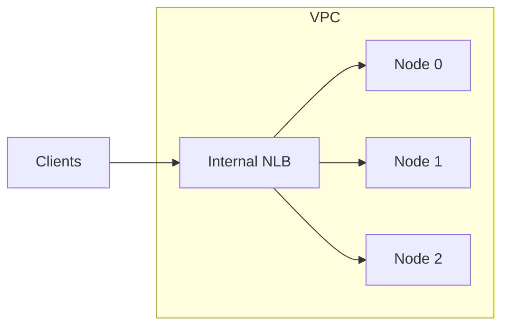

# Self-hosted Qdrant on AWS (Terraform)

A Terraform module and examples that run [Qdrant](https://qdrant.tech) on your own AWS account, so you can operate it yourself: **scale up and down, back up and restore, and use Compute Savings Plans** on the EC2 instances.

- Default region in the examples: `eu-west-1`
- Default Qdrant version: **1.20.0** (pinned; override with `qdrant_version`)
- Terraform `>= 1.10`, AWS provider `>= 6.0, < 7.0`

> **Status:** built for learning and for small production use. With `production_mode = true` the module enforces a safe topology and settings ([docs/production.md](docs/production.md)), and the 3-node stack has been deployed and put through node loss, volume loss, rolling replacement, restore and key rotation drills on real AWS (see [what has been tested](docs/production.md#what-has-actually-been-tested)). Not everything has been exercised yet. Deploy it to a staging account, work through the remaining drills in that guide, and test your restores before customers depend on it. See [Known limitations](#known-limitations).

## What you get



Each node is an EC2 instance with its own EBS volume, in its own AZ. Nodes talk to each other directly (port 6335). Backups go to S3 and EBS snapshots, and metrics and logs go to CloudWatch.

| Area | Implementation |
| --- | --- |
| Compute | One EC2 instance per node, each in its own single-instance Auto Scaling group (self-healing), Amazon Linux 2023, Graviton by default |
| Identity | Each node has its own ENI (fixed IP, so the Raft peer address is stable) and EBS gp3 volume that outlive the instance |
| Cluster | `node_count = 1` for experiments, `3` or more for a Raft cluster; Qdrant always runs in cluster mode so you can grow later |
| Access | Internal NLB (optional TLS with ACM), security groups that allow only the CIDRs or security groups you list, SSM Session Manager (no SSH) |
| Auth | API key and read-only key in Secrets Manager, fetched at start-up |
| Backups | Daily EBS snapshots (DLM) **and** daily Qdrant snapshots plus a manifest (collection configs, aliases, shard layout) to a versioned, encrypted S3 bucket, with a backup-age alarm |
| Monitoring | CloudWatch agent (memory, disk, CPU), a per-node write/read/search canary, Qdrant's own request, latency and optimizer metrics, alarms (node down, canary, peers, replica deficit, CPU, memory, disk, file descriptors, backup age, unhealthy targets), SNS topic, dashboard, container logs |
| Multi-tenancy | Options for JWT RBAC and strict-mode defaults, and a guide to shared collections, shard keys, tenant promotion and noisy neighbours ([docs/multitenancy.md](docs/multitenancy.md)) |
| Production profile | `production_mode = true` enforces 3 nodes in distinct AZs, explicit placement, an image digest, TLS, backups, monitoring, an alarm destination and a pinned AMI ([docs/production.md](docs/production.md)) |
| Cost | Plain On-Demand EC2, so Compute Savings Plans apply ([docs/savings-plans.md](docs/savings-plans.md)) |

## Layout

```
modules/qdrant/        the reusable module (inputs and outputs documented in its README)
examples/single-node/  one node, cheapest way to learn
examples/cluster/      three nodes across three AZs
examples/production/   production example (existing VPC, baked AMI and image digest, ACM certificate, SNS topic)
examples/shared/vpc/   small VPC used by the examples (one NAT gateway)
docs/                  production, multitenancy, scaling, backup and restore, operations, performance, Savings Plans
scripts/               replace-node.sh: health-gated, serial instance replacement
```

See [the production migration guide](docs/hardening-migration.md) for state locking, image preparation, plan checks, and maintenance locks.

## Quick start

Prerequisites: Terraform 1.10+, AWS credentials for a sandbox account, and the [Session Manager plugin](https://docs.aws.amazon.com/systems-manager/latest/userguide/session-manager-working-with-install-plugin.html) for the AWS CLI.

```bash
cd examples/single-node
terraform init
terraform plan
terraform apply          # about 10 minutes: VPC, NAT gateway, instance boot, image pull
```

The example creates its own VPC with a NAT gateway (billed hourly). Use your own network by passing `vpc_id` and `subnet_ids` to the module.

Connect through SSM, because the NLB is internal:

```bash
ASG=$(terraform output -json autoscaling_group_names | jq -r '.["0"]')
INSTANCE=$(aws autoscaling describe-auto-scaling-groups --auto-scaling-group-names "$ASG" \
  --query 'AutoScalingGroups[0].Instances[0].InstanceId' --output text)

aws ssm start-session --target "$INSTANCE" \
  --document-name AWS-StartPortForwardingSession \
  --parameters '{"portNumber":["6333"],"localPortNumber":["6333"]}'
```

In a second terminal:

```bash
export QDRANT_API_KEY=$(aws secretsmanager get-secret-value \
  --secret-id "$(terraform output -raw api_key_secret_arn)" \
  --query SecretString --output text | jq -r .api_key)

curl http://localhost:6333/readyz
curl -H "api-key: $QDRANT_API_KEY" http://localhost:6333/cluster

# Create a collection, add a point and search it
curl -X PUT http://localhost:6333/collections/demo -H "api-key: $QDRANT_API_KEY" \
  -H 'Content-Type: application/json' \
  -d '{"vectors": {"size": 4, "distance": "Cosine"}, "shard_number": 6}'
curl -X PUT 'http://localhost:6333/collections/demo/points?wait=true' -H "api-key: $QDRANT_API_KEY" \
  -H 'Content-Type: application/json' \
  -d '{"points": [{"id": 1, "vector": [0.1, 0.2, 0.3, 0.4], "payload": {"city": "Dublin"}}]}'
curl -X POST http://localhost:6333/collections/demo/points/query -H "api-key: $QDRANT_API_KEY" \
  -H 'Content-Type: application/json' -d '{"query": [0.1, 0.2, 0.3, 0.4], "limit": 1}'
```

Tear down when finished (see [Teardown](#teardown)): `terraform destroy`.

## Practice checklist

Work through these once to build real experience. Each one has a matching runbook.

1. **Deploy** the single-node example and run the commands above.
2. **Backups:** start a snapshot (`sudo systemctl start qdrant-snapshot.service` through SSM), see the object in S3 and the `SnapshotSuccess` metric, then do a restore into a throwaway deployment ([docs/backup-restore.md](docs/backup-restore.md)).
3. **Alarms:** stop Qdrant on the node (`sudo systemctl stop qdrant`) and watch the canary and unhealthy-targets alarms and the dashboard react, then start it again. Confirm your email subscription if you set `alarm_email`.
4. **Scale up:** change `instance_type`, apply, and replace the node with `scripts/replace-node.sh` ([docs/scaling.md](docs/scaling.md)).
5. **Scale out:** set `node_count = 3`, apply, then replicate and move shards.
6. **Failure:** terminate an instance in the EC2 console and watch the ASG replace it and re-attach its volume and IP.
7. **Lose a node's disk** and recover it ([docs/backup-restore.md](docs/backup-restore.md), scenario B).
8. **Scale in and teardown.**
9. **Savings Plans:** after a couple of weeks, read the Cost Explorer recommendation ([docs/savings-plans.md](docs/savings-plans.md)).

## Choosing a size

Qdrant is mainly memory-bound. A rough starting point for vectors held in RAM is

```
memory ≈ number_of_vectors × dimensions × 4 bytes × 1.5
```

plus payload and index overhead. See Qdrant's capacity-planning guidance for details, and reduce RAM with quantization or on-disk storage if needed.

| Instance | vCPU | RAM | Use |
| --- | --- | --- | --- |
| `m7g.large` | 2 | 8 GiB | First experiments |
| `r7g.large` | 2 | 16 GiB | Small production-like tests |
| `r7g.xlarge` | 4 | 32 GiB | Larger datasets |
| `r7g.2xlarge` | 8 | 64 GiB | Larger still; consider scaling out instead |

Data volumes are gp3: raise `data_volume_iops` and `data_volume_throughput` for on-disk indexes. See [docs/performance.md](docs/performance.md) for tuning, including placement groups.

## Cost

Estimates from [Infracost](https://www.infracost.io) (scanned 2026-10-23, `eu-west-1`, On-Demand, USD per month). They cover fixed hourly and provisioned charges only. Usage-based items (NAT and NLB data processing, S3 storage and requests, snapshot storage, CloudWatch logs, Secrets Manager API calls) are extra and depend on your traffic. The canary, backup and Qdrant-metrics checks publish roughly 17 custom CloudWatch metrics per node (turn off the Qdrant ones with `enable_qdrant_metrics = false`), a small per-node monthly charge that the estimate does not include.

| Line item | `single-node` (1 × m7g.large, 50 GiB) | `cluster` (3 × r7g.large, 100 GiB each) |
| --- | --- | --- |
| EC2 instances plus 20 GiB root volumes | $68 | $267 ($89 each) |
| EBS data volumes | $4 | $27 ($9 each) |
| NAT gateway (example VPC, one) | $35 | $35 |
| Network Load Balancer | $18 | $18 |
| CloudWatch dashboard | $3 | $3 |
| **Total (Infracost)** | **about $130** | **about $353** |

Only the EC2 line is discounted by a Compute Savings Plan ([docs/savings-plans.md](docs/savings-plans.md)). The NAT gateway is often the biggest surprise in a small test; skip it by using your own network. Re-run the estimate for your own settings with `infracost scan` (it needs a root module that sets the module variables; scanning `modules/qdrant` alone has no inputs).

## Security notes

- Nodes sit in private subnets with no SSH and no public IPs. Use SSM for shell access and port forwarding.
- IMDSv2 is required, EBS volumes and the bucket are encrypted, the bucket blocks public access and non-TLS requests.
- The instance role is scoped to the deployment's own ENIs, volumes, secret, bucket and log group.
- Always set `allowed_cidr_blocks` or `allowed_security_group_ids` as narrowly as you can; the module warns if both are empty.
- Terraform state holds the generated API keys. Use an encrypted remote backend (S3 with KMS and locking) and limit who can read it, or pass `api_key_secret_arn` to manage the secret yourself.
- Add `nlb_certificate_arn` (and `nlb_hostname`, the DNS name the certificate covers, aliased to the NLB) to encrypt client traffic. Node-to-node traffic inside the VPC is not encrypted.

## Known limitations

- **No automatic rebalancing.** Moving shards after you add or remove nodes is a manual API step ([docs/scaling.md](docs/scaling.md)).
- **One AZ per node.** A node is unavailable if its AZ is, until the AZ recovers. Use `production_mode` (3 nodes in 3 AZs) and `replication_factor >= 2`.
- **Backups are daily and per node.** Expect up to about a day of data loss in a total loss; cluster-wide recovery is a procedure to practise ([docs/backup-restore.md](docs/backup-restore.md)).
- **No rolling updates from Terraform.** Launch template changes apply to the next instance replacement; use `scripts/replace-node.sh` one node at a time. This is deliberate, so a single apply cannot take the whole cluster down.
- **Single-node downtime during replacement.** With `node_count = 1` there is a gap of a few minutes while the instance is replaced.
- **Outbound internet needed** (NAT) for package install and image pulls unless you use a baked AMI or private mirrors. Only Nitro instance types are supported. Private ECR pulls and pre-cached images are supported.
- **Some changes need a manual step.** Replacing a node's volume or ENI requires scaling its ASG to zero first ([docs/operations.md](docs/operations.md)).
- **Self-managed means you own upgrades and incidents.** Read [docs/operations.md](docs/operations.md).
- `terraform test` (mocked provider) covers plan-time behaviour only. Start-up scripts, node recovery and restores were tested on real AWS for the 3-node stack ([docs/production.md](docs/production.md#what-has-actually-been-tested)); repeat the drills in your own account.

## Teardown

```bash
terraform destroy
```

- Data volumes take a final EBS snapshot first (`final_snapshot_on_destroy`). Delete those snapshots and the DLM-created ones yourself when you no longer need them.
- The S3 snapshot bucket is only deleted when empty, unless `force_destroy_snapshot_bucket = true` (set in the examples).
- The generated secret is deleted immediately in the examples (`secret_recovery_window_days = 0`). The module default is 7 days.
- CloudWatch log groups and alarms are removed. The VPC example removes the NAT gateway and its Elastic IP.

## Troubleshooting

| Symptom | Check |
| --- | --- |
| `terraform apply` waits on the Auto Scaling group | The instance may not have outbound internet access: confirm the NAT route |
| Node never becomes healthy | Session Manager into the node: `journalctl -u qdrant`, `/var/log/cloud-init-output.log`, and the CloudWatch log group |
| `Timed out attaching eni/volume` in the journal | The previous instance is still shutting down; the script retries for 10 minutes. Check the volume and ENI are in the same AZ as the node's subnet |
| 401/403 from Qdrant | Use the `api-key` header with the key from the secret |
| New node in a cluster has no data | Expected: replicate or move shards ([docs/scaling.md](docs/scaling.md)) |
| Unhealthy-targets alarm but instance is up | Qdrant is not ready; check logs. The ASG does not replace instances for this, so restart the service or run `scripts/replace-node.sh` |
